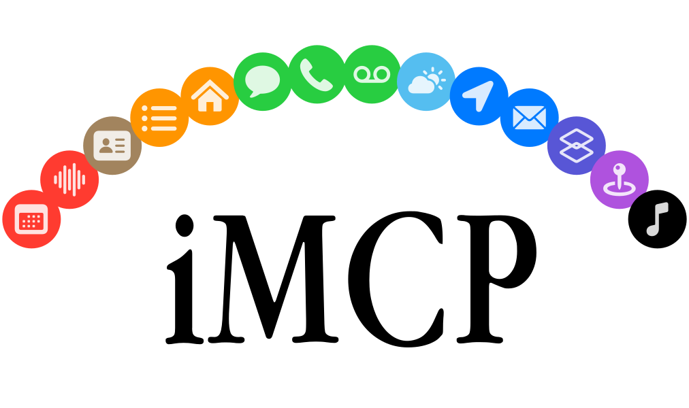

<picture>
  <source media="(prefers-color-scheme: dark)" srcset="Assets/hero-dark.svg">
  <source media="(prefers-color-scheme: light)" srcset="Assets/hero-light.svg">
  
</picture>

iMCP is a macOS app for connecting your digital life with AI.
It works with [Claude Desktop][claude-app],
the [ChatGPT desktop app][chatgpt-app],
local models served by [llama.cpp][llama-cpp],
and a [growing list of clients][mcp-clients] that support the
[Model Context Protocol (MCP)][mcp].

## Capabilities

<table>
  <tr>
    <th width="48">
      
    </th>
    <td><strong>Calendar</strong></td>
    <td>View and manage calendar events, including creating new events with customizable settings like recurrence, alarms, and availability status.</td>
  </tr>
  <tr>
    <th width="48">
      
    </th>
    <td><strong>Contacts</strong></td>
    <td>Access contact information about yourself and search your contacts by name, phone number, or email address.</td>
  </tr>
  <tr>
    <th width="48">
      
    </th>
    <td><strong>Home</strong></td>
    <td>Find homes, rooms, accessories, scenes, and automations, read and control accessories, and organize rooms and zones. Needs a helper app that you <a href="#imcp-helper">build with your own Apple Developer account</a>.</td>
  </tr>
  <tr>
    <th width="48">
      
    </th>
    <td><strong>Location</strong></td>
    <td>Access current location data and convert between addresses and geographic coordinates.</td>
  </tr>
  <tr>
    <th width="48">
      
    </th>
    <td><strong>Mail</strong></td>
    <td>List mailboxes, search messages by sender, subject, mailbox, date, or read status, read messages stored on your Mac, and open new drafts in your default email app. Reading mail needs <a href="#mail-access-and-search">access to your Mail folder</a>.</td>
  </tr>
  <tr>
    <th width="48">
      
    </th>
    <td><strong>Maps</strong></td>
    <td>Provides location services including place search, directions, points of interest lookup, travel time estimation, and static map image generation.</td>
  </tr>
  <tr>
    <th width="48">
      
    </th>
    <td><strong>Messages</strong></td>
    <td>Access message history with specific participants within customizable date ranges.</td>
  </tr>
  <tr>
    <th width="48">
      
    </th>
    <td><strong>Music</strong></td>
    <td>See what's playing in the Music app, control playback, and search the Apple Music catalog. Playback tools need Automation permission for Music; catalog search needs Apple Music access.</td>
  </tr>
  <tr>
    <th width="48">
      
    </th>
    <td><strong>Notes</strong></td>
    <td>Search notes by text, folder, or date, and read them as Markdown with their checklists, tables, and links.</td>
  </tr>
  <tr>
    <th width="48">
      
    </th>
    <td><strong>Phone</strong></td>
    <td>View call history synced from your iPhone, filter calls by participant, date, or call type, and start calls with system confirmation.</td>
  </tr>
  <tr>
    <th width="48">
      
    </th>
    <td><strong>Reminders</strong></td>
    <td>View, create, edit, and delete reminders with customizable due dates, recurrence, priorities, and alerts across different reminder lists, and manage the lists themselves.</td>
  </tr>
  <tr>
    <th width="48">
      
    </th>
    <td><strong>Shortcuts</strong></td>
    <td>List and run shortcuts on your Mac, with optional text input.</td>
  </tr>
  <tr>
    <th width="48">
      
    </th>
    <td><strong>Voice Memos</strong></td>
    <td>Fetch recordings from Voice Memos, with transcripts and audio, filtering by title, folder, or date, or reading Recently Deleted. Needs <a href="#voice-memos-library-access">access to your Voice Memos folder</a>.</td>
  </tr>
  <tr>
    <th width="48">
      
    </th>
    <td><strong>Voicemail</strong></td>
    <td>Fetch voicemails synced from your iPhone, with transcripts and audio, filtering by sender, date, message type, or mailbox (inbox, blocked, or deleted).</td>
  </tr>
  <tr>
    <th width="48">
      
    </th>
    <td><strong>Weather</strong></td>
    <td>Access current weather conditions including temperature, wind speed, and weather conditions for any location.</td>
  </tr>
</table>

## Getting Started

To use iMCP, you need two apps:
iMCP, which gives access to the services you turn on,
and an AI app that can connect to MCP servers.
Install iMCP and turn on services first.
Then follow the instructions for your AI app:

- [Claude Desktop](#connect-to-claude-desktop)
- [ChatGPT desktop app](#connect-to-the-chatgpt-desktop-app)
- [Claude Code, llama.cpp, and other clients](#connect-to-other-clients)

### Download and open the app

First, [download the iMCP app](https://iMCP.app/download)
(requires macOS 15.3 or later).

Or, if you have [Homebrew](https://brew.sh) installed,
you can run the following command:

```console
brew install --cask mattt/tap/iMCP
```


When you open the app,
you'll see a

icon in your menu bar.

Click this icon to open the iMCP menu.
The blue "Enable MCP Server" switch at the top indicates that
the MCP server is running and ready to connect with AI apps.
iMCP must be open for AI apps to use it.

Below the switch, the menu lists the available services.
Maps is on when you first open iMCP;
the other services are off and appear in gray.
iMCP also includes a tool that plays a system sound.
That tool is always available, even with every service off,
so you can test a connection without granting any permissions.

<br clear="all">


### Turn on services

To turn on a service, click its icon.
macOS asks you for permission.
For example, when you turn on Calendar,
a dialog asks "'iMCP' Would Like Full Access to Your Calendar".
Click "Allow Full Access" to continue.

> [!IMPORTANT]
> iMCP **does not** collect or store any of your data.
> AI apps like Claude and ChatGPT _do_ send
> your data off device as part of tool calls.
> Turn on only the services you want your AI app to use.
> To keep your data on your Mac,
> [use a local model with llama.cpp](#llamacpp).

<br clear="all">


When a service is on,
its icon changes from gray to the service's color:
red for Calendar, green for Messages, blue for Location, and so on.

Repeat these steps for each service that you want to use.
macOS asks for each permission separately,
so iMCP can access only the data that you allow.
To turn off a service, click its icon again.
To turn off individual tools in a service,
click 
\> "Settings", and then click "Services".

<br clear="all">

### Approve connections


The first time an AI app connects,
iMCP shows a "Client Connection Request" dialog
with the name the app reports
and the services that the app can use.
Click "Allow" to connect.
To skip this dialog next time, select "Always trust this client";
iMCP then shows a notification each time the app connects.
You can remove trusted clients in

\> "Settings" > "General".

<br clear="all">

### Mail access and search

Mail store access uses [Envelope](https://github.com/mattt/Envelope),
which reads the local index and message files
and selects readable content with its internal MIME reader.
iMCP manages folder access, tool arguments, JSON output, and composition.

Mail reading requires access to `~/Library/Mail`.
If folder access is unavailable, `mail_compose` can still open a compose window
in the default email app.
It does not save or send a message.

Mail reads use a read-only SQLite connection and require WAL journal mode.
iMCP does not change the index's journal mode or run checkpoints.
It permits one Mail database connection at a time;
concurrent reads wait their turn,
and a read returns an error if SQLite reports a lock conflict.
Each SQL statement has a 100 ms execution budget,
all statements of one read share a 1 s budget,
and statements check task cancellation.
The deadline is cooperative; it cannot interrupt a filesystem operation
while SQLite is waiting for that operation to finish.
Slow searches can fail instead of returning results.
Service status checks do not open SQLite connections,
and message reads close the database before scanning mailbox files.
These limits reduce interference, but active reads can still delay WAL checkpoints.

Use the `@id` string from `mail_mailboxes_list` as the `mailbox` filter
in `mail_messages_search`, for example `{"mailbox": "V10:12"}`.
The identifier includes the Mail store,
so an identifier from before a Mail store upgrade returns an error.
The `url` field describes storage and is not a search identifier.
Each mailbox includes an account identifier when available.
The account's `email` field comes from Mail's local account map;
it is `null` when that map is missing or does not contain an email address.

Search results include `localIndex.indexedMessageCount` for the selected mailbox,
or all mailboxes when no mailbox is selected, before filters and pagination.
This count includes label membership without counting a message twice.
Sync status is reported as `unknown`.
A count of zero can mean an empty mailbox or missing local indexing;
it cannot show whether Mail has ever indexed the account.
Open Mail to check account sync.

Search results are newest first.
When more messages match, the result includes a `nextCursor` value;
pass it as `cursor` with the same filters to get the next page.
A cursor names the last message of a page,
so mail that arrives between requests does not shift later pages.

Search matches sender and subject metadata only.
`mail_messages_read` can read the local content of a returned message.
It lists attachments without their content.
When Mail stores a message's attachments or inline images in separate files,
the message file keeps the text, and each of those attachments has
`isStoredSeparately` set to `true`.
Body search is not available, and these tools do not download messages.

### Connect to Claude Desktop

If you don't have Claude Desktop installed,
you can [download it here](https://claude.ai/download).

Open Claude Desktop and choose Claude > "Settings" (<kbd>⌘</kbd><kbd>,</kbd>).
Click "Developer" in the sidebar,
and then click "Edit Config".
This creates a configuration file at
`~/Library/Application Support/Claude/claude_desktop_config.json`.

<br/>

To connect iMCP to Claude Desktop,
click 
\> "Configure Claude Desktop",
and then click "Set Up".

iMCP adds or updates its entry in the configuration file
so that Claude Desktop starts the `imcp-server` executable in the app.
iMCP keeps the other MCP servers in the file.

<details>
<summary>Configure Claude Desktop manually</summary>

Click 
\> "Copy server command to clipboard".
Then open `claude_desktop_config.json` in your editor
and enter the following:

```json
{
  "mcpServers": {
    "iMCP": {
      "command": "{paste iMCP server command}"
    }
  }
}
```

</details>

### Call iMCP tools from Claude Desktop

Quit and reopen the Claude Desktop app.
iMCP asks you to [approve the connection](#approve-connections).

After you approve the connection,
a 🔨 icon with the number of available tools
appears in the lower-right corner of the chat box.
Click it to see the iMCP tools that Claude can use.

<p align="center">
  
</p>

Now you can ask Claude questions that require access to your personal data,
such as:

> "How's the weather where I am?"

Claude uses iMCP tools to get this information,
so you don't have to share it in the conversation yourself.

<p align="center">
  
</p>

### Connect to the ChatGPT desktop app

If you don't have the ChatGPT desktop app installed,
you can [download it here][chatgpt-app].

> [!NOTE]
> These steps use the labels in ChatGPT 26.930 for macOS
> and haven't been tested end to end yet.
> OpenAI documents MCP servers for
> [Codex mode](https://learn.chatgpt.com/docs/extend/mcp),
> so use iMCP in a Codex conversation.

1. Click 
   \> "Copy server command to clipboard".
2. In ChatGPT, open Settings (<kbd>⌘</kbd><kbd>,</kbd>)
   and click "MCP servers" in the sidebar.
3. Click "Add server".
   Enter `iMCP` for "Name", choose "STDIO" for "Type",
   and paste the copied command into "Command to launch".
   Leave the other fields empty.
4. Click "Save", and then click "Restart".
5. [Approve the connection](#approve-connections) in iMCP.
   ChatGPT might identify itself as `codex-mcp-client`.

To test the connection,
start a new Codex conversation and send this message:

> "Use iMCP to play a system sound."

Your Mac plays a short sound.
If your Mac is muted, open the tool call in the conversation;
a result of `true` means that iMCP received the request.

<details>
<summary>Troubleshooting the ChatGPT desktop app</summary>

- **Settings doesn't show "MCP servers".**
  Update ChatGPT and switch to Codex mode.
  If ChatGPT shows "MCP server settings are unavailable"
  and an organization manages your account,
  ask your administrator whether you can add MCP servers.
- **iMCP doesn't show an approval dialog.**
  ChatGPT can't open iMCP for you.
  Make sure that iMCP is open and "Enable MCP Server" is on,
  and then click "Restart" in ChatGPT's "MCP servers" settings.
  The dialog can also open behind other windows.
  If you trusted ChatGPT before,
  iMCP shows a notification instead of a dialog.
- **ChatGPT can't use iMCP tools.**
  Make sure that you're in a Codex conversation
  and that iMCP is turned on in ChatGPT's "MCP servers" settings.
  If you clicked "Deny", click "Restart" to see the dialog again.
  If you turned on a service after connecting, click "Restart"
  so that ChatGPT loads its tools.
- **A service doesn't turn on in iMCP.**
  If you denied permission when macOS asked,
  open System Settings > "Privacy & Security",
  click the category for the service, such as "Calendars",
  and turn on iMCP.
  Then click the service icon in the iMCP menu again.
- **ChatGPT shows an error for the iMCP server.**
  The command might point to the wrong place,
  for example, if you moved iMCP after setting it up.
  Copy the server command again,
  open the iMCP server's settings in ChatGPT,
  and replace "Command to launch" with the copied command.
  Make sure that "Arguments" is empty,
  and then click "Save" and "Restart".

</details>

### Connect to other clients

Most MCP clients can start iMCP as a local server
that uses the STDIO transport.
Click 
\> "Copy server command to clipboard",
and then enter the copied command
as the command for a new STDIO server in your client.
The copied command is the full path to the `imcp-server` executable
in your copy of iMCP.

The commands below assume that iMCP is in your Applications folder.
If you installed iMCP somewhere else,
replace `/Applications/iMCP.app/Contents/MacOS/imcp-server`
with the copied command.

#### [Claude Code][claude-code]

To add iMCP for all of your projects, run this command:

```console
claude mcp add --scope user iMCP -- /Applications/iMCP.app/Contents/MacOS/imcp-server
```

<details>
<summary>Or import from Claude Desktop</summary>

If you've already configured Claude Desktop, you can import its MCP servers:

```console
claude mcp add-from-claude-desktop
```

</details>

#### [llama.cpp][llama-cpp]

You can use iMCP with an open model that runs on your Mac
through [llama.cpp][llama-cpp],
so your conversations and tool results stay on your Mac.
`llama-server` (or `llama serve`) starts the MCP servers
listed in a configuration file
and gives their tools to models in its web UI.
This requires llama.cpp 0.1.0 or later.

Create a file at `~/.config/llama/mcp.json` with the following contents:

```json
{
  "mcpServers": {
    "imcp": {
      "command": "/Applications/iMCP.app/Contents/MacOS/imcp-server"
    }
  }
}
```

Then start the server with the `--mcp-servers-config` option
and a model that supports tool calling:

```console
llama serve --mcp-servers-config ~/.config/llama/mcp.json \
            -hf ggml-org/Qwen3-4B-GGUF
```

Open the web UI at <http://localhost:9931>
(llama.cpp versions before 0.7.0 use port 8080).
iMCP tools appear with an `imcp_` prefix,
such as `imcp_weather_current`.
The web UI asks you before it runs each tool call,
unless you choose to always allow that tool.

<details>
<summary>Use the Llama app</summary>

[Llama][llama-app] is a menu bar app that runs `llama serve` for you.
It doesn't have a setting for MCP servers,
so add the `--mcp-servers-config` option to its custom server arguments:

```console
defaults write app.llama.Llama extraServerArgs -string "--mcp-servers-config $HOME/.config/llama/mcp.json"
```

Llama splits this value at each space and doesn't expand `~`,
so use the full path to the file, without spaces.
If you already set custom server arguments,
add the option to your existing value.
Quit and reopen Llama,
then open the web UI at <http://localhost:9931>.

</details>

> [!IMPORTANT]
> When the server starts,
> it waits 10 seconds for iMCP to list its tools.
> If you don't [approve the connection](#approve-connections)
> from "llama.cpp" in that time,
> no iMCP tools appear until you restart the server.

## Technical Details

### App & CLI

iMCP is a macOS app that bundles a command-line executable, `imcp-server`.

- [`iMCP.app`](/App/) provides UI for configuring services and — most importantly —
  a means of interacting with macOS system permissions,
  so that it can access Contacts, Calendar, and other information.
- [`imcp-server`](/CLI/) provides an MCP server that
  uses standard input/output for communication
  ([stdio transport][mcp-transports]).

The app and CLI communicate with each other on the local network
using [Bonjour][bonjour] for automatic discovery.
Both advertise a service with type "\_mcp.\_tcp" and domain "local".
Requests from MCP clients are read by the CLI from `stdin`
and relayed to the app;
responses from the app are received by the CLI and written to `stdout`.
See [`StdioProxy`](https://github.com/mattt/iMCP/blob/8cf9d250286288b06bf5d3dda78f5905ad0d7729/CLI/main.swift#L47)
for implementation details.

For this project, we created what became
[the official Swift SDK][swift-sdk]
for Model Context Protocol servers and clients.
The app uses this package to handle proxied requests from MCP clients.

### iMessage Database Access

Apple doesn't provide public APIs for accessing your messages.
However, the Messages app on macOS stores data in a SQLite database located at
`~/Library/Messages/chat.db`.

iMCP runs in [App Sandbox][app-sandbox],
which limits its access to user data and system resources.
When you go to enable the Messages service,
you'll be prompted to select your `~/Library/Messages` folder through the standard file picker.
When you do, macOS adds that folder to the app's sandbox.
[`NSOpenPanel`][nsopenpanel] is magic like that.
The folder matters: `chat.db` is a WAL-mode database,
and Messages writes every new message to `chat.db-wal` next to it first,
only folding the log into `chat.db` at a checkpoint every few MB —
often hours later.
A grant on `chat.db` alone (what earlier versions asked for)
leaves that log unreadable, so the newest messages were missing until then.
If you granted `chat.db` with an earlier version, Messages keeps working from the last checkpoint;
switch Messages off and on in the iMCP menu to grant the folder instead.

Attachment files are a separate matter.
The sandbox walls off `~/Library/Messages/Attachments` from a grant on its parent folder,
so reading message attachments (`messages_attachment_read`)
asks for that subfolder through the same picker —
a second, read-only grant of its own.
Granting it is optional:
declining leaves `messages_attachment_read` unable to read files,
while everything else keeps working.
If you granted the Messages folder before attachments were supported,
switch Messages off and on in the iMCP menu to be asked for it.

But opening the iMessage database is just half the battle.
Over the past few years,
Apple has moved away from storing messages in plain text
and instead toward a proprietary `typedstream` format.

For this project, we created [Madrid][madrid]:
a Swift package for reading your iMessage database.
It includes a Swift implementation for decoding Apple's `typedstream` format,
adapted from Christopher Sardegna's [imessage-exporter] project
and [blog post about reverse-engineering `typedstream`][typedstream-blog-post].

### Call History Database Access

Call history synced from your iPhone lives in a SQLite database at
`~/Library/Application Support/CallHistoryDB/CallHistory.storedata`.
Recent calls sit in its write-ahead log next to the store file,
so the Phone service asks you to open the `CallHistoryDB` folder
rather than the file alone.

### Visual Voicemail Database Access

Voicemails synced from your iPhone by the Phone app (on macOS 26 and later)
live in a SQLite database at
`~/Library/Group Containers/group.com.apple.FaceTime/com.apple.facetimemessagestored/Data Store/FaceTimeMessageStore-local.sqlitedb`.
The store is a write-ahead log database, and the message audio sits in an `Assets`
tree beside it, so the Voicemail service asks you to open the `Data Store` folder
rather than the file alone.

### Voice Memos Library Access

Voice Memos keeps its library in a SQLite database at
`~/Library/Group Containers/group.com.apple.VoiceMemos.shared/Recordings/CloudRecordings.db`.
The audio files sit beside the database,
so the Voice Memos service asks you to open the `Recordings` folder
rather than the file alone.
Voice Memos writes each transcript into the audio file of its recording,
so a recording has a transcript only when its audio is on your Mac.

For this project, we created [TSRP][tsrp]:
a Swift package for reading your Voice Memos library.
It reads transcripts from both `.m4a` and `.qta` files,
which keep them in different places.

### Notes Database Access

Apple doesn't provide public APIs for accessing your notes, either.
The Notes app keeps them in a SQLite database at
`~/Library/Group Containers/group.com.apple.notes/NoteStore.sqlite`.
Recent edits sit in its write-ahead log,
so the Notes service asks you to open the `group.com.apple.notes` folder
rather than the file alone.
iMCP only reads the database; it never changes your notes.

Each note's contents are stored as a gzip-compressed protocol buffer:
the text, followed by runs that give the formatting of each part of it.
Tables are stored separately, as the state of a CRDT
that lists the rows, the columns, and the cell at each intersection.
Notes locked with a password are encrypted,
so iMCP can find them by title but can't read their contents.

For this project, we created [TopoText][topotext]:
a Swift package for reading the Notes database,
named after Apple's internal name for the note text format.
It builds on the reverse engineering in Jon Baumann's
[apple_cloud_notes_parser][apple-cloud-notes-parser]
and Steve Dunham's [notesutils][notesutils].
The Notes service reads notes with TopoText and returns them as Markdown.

### JSON-LD for Tool Results

The tools provided by iMCP return results as
[JSON-LD][json-ld] documents.
For example,
the `fetchContacts` tool uses the [Contacts framework][contacts-framework],
which represents people and organizations with the [`CNContact`][cncontact] type.
Here's how an object of that type is encoded as JSON-LD:

```json
{
  "@context": "https://schema.org",
  "@type": "Person",
  "name": "Mattt",
  "url": "https://mat.tt"
}
```

[Schema.org][schema.org] provides standard vocabularies for
people, postal addresses, events, and many other objects we want to represent.
And JSON-LD is a convenient encoding format for
humans, AI, and conventional software alike.

For this project, we created [Ontology][ontology]:
a Swift package for working with structured data.
It includes convenience initializers for types from Apple frameworks,
such as those returned by iMCP tools.

### iMCP Helper

Apple doesn't make the HomeKit framework available to native macOS apps,
only to Mac Catalyst apps.
So the Home service runs in a separate Catalyst app,
[`iMCP Helper`](/Helper/).
Apple doesn't allow HomeKit in Developer ID apps,
so iMCP's release build doesn't include the helper.
Build and install it with your own Apple Developer account:

```console
git clone https://github.com/mattt/iMCP.git
cd iMCP
Scripts/install-helper.sh
```

The script signs the helper with your team's development certificate
and installs it in `/Applications`.
Run it with `--help` to choose another team, bundle ID, or install directory.
Xcode must be signed in to your account (Xcode > Settings > Accounts),
and the helper runs only on Macs registered to your team.
Whether free personal teams can use HomeKit isn't verified.
Then turn on Home in iMCP.
iMCP finds the helper in `/Applications`.
If you installed it somewhere else,
iMCP asks you to choose it when you turn on Home,
or you can choose it in Settings > Services > Home.
When you enable Home,
iMCP launches the helper if it isn't running,
and the helper asks for HomeKit access.
The first time, the helper's window shows an eight-character pairing code,
such as `7KQ2-M9XD`, and numbered steps:
click Copy Code,
click Open iMCP… to open iMCP's Pair with iMCP Helper window,
then paste the code and click Pair.
The button opens the URL `imcp://pair`, which carries no data;
iMCP only opens its pairing window for it.
The helper opens that URL only with the app that has iMCP's bundle ID, `co.dododo.iMCP`,
preferring the running copy, and not with a copy that doesn't declare the `imcp` scheme;
otherwise, for example if you built iMCP with another bundle ID,
the helper tells you to choose Pair… in Settings > Services > Home instead.
If the helper's window is behind other windows,
click Open iMCP Helper… in iMCP's window.
The code works once:
when you pair, iMCP sends the helper a new random key,
and both apps keep that key in their keychains.
After five wrong codes, the helper shows a new one.
To pair again, click Pair Again… in the helper's window and confirm;
the helper ends iMCP's connection and shows a new code and the same steps.
The helper keeps running after iMCP quits;
choose Quit iMCP Helper from its app menu, or press Command-Q, to stop it.
The window also reports startup and permission errors.
The Mac's iCloud account must have access to the home,
and writes can require the owner or administrator role.

Sparkle updates iMCP but not the helper.
After an iMCP update,
rebuild the helper from the tag that matches the new version:

```console
git fetch --tags
git checkout <version>
Scripts/install-helper.sh
```

A helper from an older version may not match the app's Home tools.

The helper's development certificate and provisioning profile expire.
Each is usually valid for one year,
but the certificate can expire first.
To read the profile's expiration date, run:

```console
security cms -D -i "/Applications/iMCP Helper.app/Contents/embedded.provisionprofile" |
  plutil -extract ExpirationDate raw -o - -
```

To read the certificate's expiration date, run:

```console
codesign -d --extract-certificates=/tmp/imcp-helper-cert "/Applications/iMCP Helper.app"
openssl x509 -inform DER -in /tmp/imcp-helper-cert0 -noout -enddate
```

After the earlier of the two dates, the helper may stop launching.
Run `Scripts/install-helper.sh` again to renew it;
the script lets Xcode create a new certificate and profile
when the old ones have expired.

On the first run, provisioning can fail with "PLA Update available".
The team's Account Holder must accept the latest Program License Agreement
in the Apple Developer account.
If you can't write to `/Applications` (for example, as a non-admin user),
the install can fail with a permission error.
Run the script with `--destination ~/Applications` instead.
iMCP then asks you to choose the helper.

Both apps compile the same tool definitions from
[`Shared/Home/HomeTools.swift`](/Shared/Home/HomeTools.swift).
The helper implements them with HomeKit;
the app forwards each call over an MCP connection on the loopback interface,
so the usual service and per-tool switches apply.
Object IDs are HomeKit UUID strings.
Inventory tools return live characteristic values only when `include_values` is true,
with a five-second timeout and at most four outstanding HomeKit reads.
After a lost connection, read-only calls retry once.
Writes are not repeated, because HomeKit may have applied them already;
the error asks the caller to inspect the home before retrying.

The helper advertises "\_imcp-helper.\_tcp" on the local-only DNS-SD interface,
and iMCP finds it there, whether or not iMCP launched it.
If more than one helper is running,
iMCP tries the one at the chosen location first, then the others.
Connections use TLS with the key from pairing as a pre-shared key,
so a connection without the key fails the TLS handshake.
The cipher suite adds an ECDHE key exchange,
so a recorded connection stays secret even if the key or code is found later.
The pairing connection uses a key derived from the code with PBKDF2,
which makes each guess slow for a process
that advertises itself as the helper while you pair.
If you built the helper with an earlier version of iMCP,
quit it and rebuild it with `Scripts/install-helper.sh`;
iMCP refuses a helper that doesn't declare the current protocol version.
With Home turned on in iMCP,
`uv run Scripts/check-home.py <path-to-imcp-server>` runs a read-only
integration check through iMCP.

#### Building the helper

Building the `iMCP` scheme runs
[`Scripts/build-helper.sh`](/Scripts/build-helper.sh),
which builds the `iMCP Helper` scheme for Mac Catalyst in its own
derived-data directory and copies the product into the app.
A direct target dependency selects the iOS variant of the helper,
so the nested build is required.
Release builds set `EMBED_HOME_HELPER = NO` and leave the helper out.

The HomeKit entitlement requires a development certificate and a
provisioning profile with the HomeKit capability.
So the helper uses automatic signing with team `TTY35UM57S`
in both Debug and Release, even though the native Debug app is unsigned.
To build with another team, change it in the helper target's
Signing & Capabilities tab.
The first Mac Catalyst build for a new bundle ID can fail with
"Entitlement com.apple.developer.homekit not found and could not be included in profile",
because automatic provisioning registers the capability only for the iOS destination.
`Scripts/install-helper.sh` handles this by building for iOS once and retrying.
To do it by hand, build the helper once for iOS to register it,
then build for Mac Catalyst:

```console
xcodebuild -scheme "iMCP Helper" -destination "generic/platform=iOS" \
  -allowProvisioningUpdates build
xcodebuild -scheme "iMCP Helper" -destination "platform=macOS,variant=Mac Catalyst" \
  -allowProvisioningUpdates build
```

CI builds both apps unsigned,
which checks compilation and packaging but can't access HomeKit:

```console
xcodebuild -scheme iMCP -configuration Debug -destination "platform=macOS" \
  CODE_SIGNING_ALLOWED=NO CODE_SIGNING_REQUIRED=NO \
  HELPER_CODE_SIGNING_ALLOWED=NO build
```

## Debugging

### Allowing local network access

`imcp-server` finds the iMCP app with Bonjour,
so it needs permission to access the local network.
`imcp-server` has its own entry in
System Settings > Privacy & Security > Local Network,
separate from iMCP and from the app that runs it, such as your terminal.
If that entry is turned off,
`imcp-server` can't find the app
and reports that Bonjour service discovery timed out.

### Using the MCP Inspector

To debug interactions between iMCP and clients,
you can use the [inspector tool](https://github.com/modelcontextprotocol/inspector)
(requires Node.js):

1. Click  > "Copy server command to clipboard"
2. Open a terminal and run the following commands:

   ```console
   # Download and run inspector package on imcp-server
   npx @modelcontextprotocol/inspector [paste-copied-command]

   # Open inspector web app running locally
   open http://127.0.0.1:6274
   ```

Inspector lets you see all requests and responses between the client and the iMCP server,
which is helpful for understanding how the protocol works.

### Using Companion


[Companion][companion] is a utility for testing and debugging your MCP servers
(requires macOS 15 or later).
It gives you an easy way to browse and interact with
a server's prompts, resources, and tools.
Here's how to connect it to iMCP:

1. Click  > "Copy server command to clipboard"
2. [Download][companion-download] and open the Companion app
3. Click the <kbd>+</kbd> button in the toolbar to add an MCP server
4. Fill out the form:
   - Enter "iMCP" as the name
   - Select "STDIO" as the transport
   - Paste the copied iMCP server command
   - Click "Add Server"

<br clear="all">

## Acknowledgments

- [Justin Spahr-Summers](https://jspahrsummers.com/)
  ([@jspahrsummers](https://github.com/jspahrsummers)),
  David Soria Parra
  ([@dsp-ant](https://github.com/dsp-ant)), and
  Ashwin Bhat
  ([@ashwin-ant](https://github.com/ashwin-ant))
  for their work on MCP.
- [Christopher Sardegna](https://chrissardegna.com)
  ([@ReagentX](https://github.com/ReagentX))
  for reverse-engineering the `typedstream` format
  used by the Messages app.

## License

This project is available under the MIT license.
See the LICENSE file for more info.

## Legal

iMessage® is a registered trademark of Apple Inc.
This project is not affiliated with, endorsed, or sponsored by Apple Inc.

[app-sandbox]: https://developer.apple.com/documentation/security/app-sandbox
[apple-cloud-notes-parser]: https://github.com/threeplanetssoftware/apple_cloud_notes_parser
[bonjour]: https://developer.apple.com/bonjour/
[chatgpt-app]: https://chatgpt.com/download
[claude-app]: https://claude.ai/download
[claude-code]: https://claude.com/product/claude-code
[companion]: https://github.com/mattt/Companion
[companion-download]: https://github.com/mattt/Companion/releases/latest/download/Companion.zip
[contacts-framework]: https://developer.apple.com/documentation/contacts
[cncontact]: https://developer.apple.com/documentation/contacts/cncontact
[imessage-exporter]: https://github.com/ReagentX/imessage-exporter
[json-ld]: https://json-ld.org
[llama-app]: https://llama.app
[llama-cpp]: https://github.com/ggml-org/llama.cpp
[madrid]: https://github.com/mattt/Madrid
[mcp]: https://modelcontextprotocol.io/introduction
[mcp-clients]: https://modelcontextprotocol.io/clients
[mcp-transports]: https://modelcontextprotocol.io/docs/concepts/architecture#transport-layer
[notesutils]: https://github.com/dunhamsteve/notesutils
[nsopenpanel]: https://developer.apple.com/documentation/appkit/nsopenpanel
[ontology]: https://github.com/mattt/Ontology
[schema.org]: https://schema.org
[swift-sdk]: https://github.com/modelcontextprotocol/swift-sdk
[topotext]: https://github.com/mattt/TopoText
[tsrp]: https://github.com/mattt/TSRP
[typedstream-blog-post]: https://chrissardegna.com/blog/reverse-engineering-apples-typedstream-format/
